### Android · iOS Developer

I build native mobile apps for **Android** and **iOS**, with a focus on clean architecture and reliable Bluetooth LE connectivity.

🏢&nbsp;[MedicalSystemLab](https://github.com/MedicalSystemLab) &nbsp;·&nbsp; 📍&nbsp;Daejeon,&nbsp;South&nbsp;Korea

## 🛠️ Tech Stack

  <picture>
    <source media="(prefers-color-scheme: dark)" srcset="https://skillicons.dev/icons?i=kotlin%2Cjava%2Candroidstudio%2Cgradle%2Cswift%2Cgit%2Cgithub&theme=dark"/>
    
  </picture>

| Platform | Frameworks & Libraries |
|:---|:---|
| **Android** | Jetpack Compose · Coroutines & Flow · Hilt · Room |
| **iOS** | UIKit · Combine · SwiftUI |
| **Common** | Bluetooth LE · REST · Socket.IO |

## 📊 Contributions

<picture>
  <source media="(prefers-color-scheme: dark)" srcset="https://raw.githubusercontent.com/CODUCK-Kim/CODUCK-Kim/output/contributions-dark.svg"/>
  
</picture>
